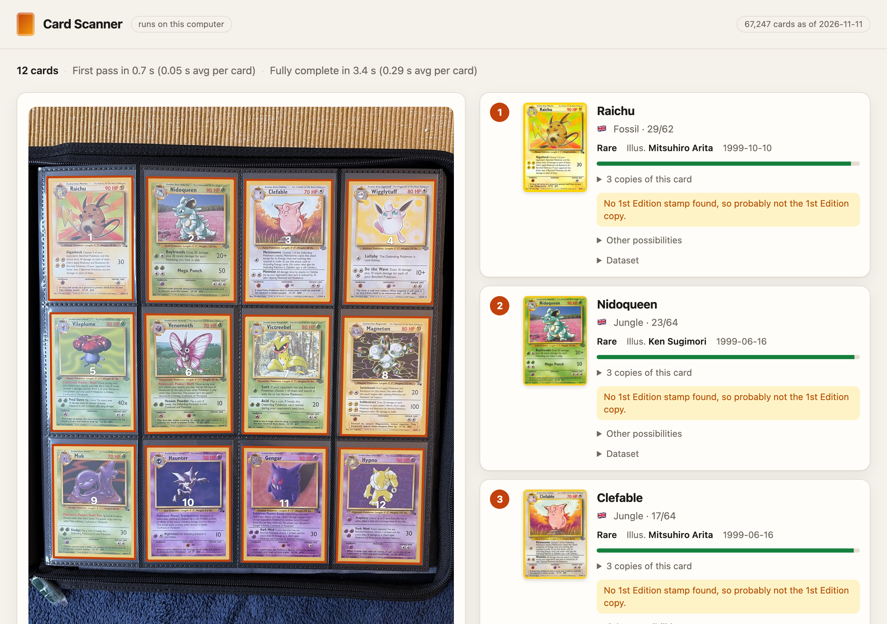

# CardCorpus Scanner

Name Pokémon trading cards in photos. Point it at a binder page, a table
of cards or a single card, and it finds every card in the picture and tells
you which print each one is, in English, Japanese or Simplified Chinese,
from 1996 to this year's sets.

Each answer is the card's address in the [CardCorpus dataset](https://cardcorpus.com)
([github.com/cardcorpus/pokemon-card-dataset](https://github.com/cardcorpus/pokemon-card-dataset)),
an open dataset of every Pokémon card, so everything else about the card
(its set, rarity, illustrator, copies, other languages, pictures) is one
request away.

This repository is the reference implementation in Python. The weights and
the reference index are on the Hugging Face Hub at
[cardcorpus/pokemon-card-scanner](https://huggingface.co/cardcorpus/pokemon-card-scanner).



## Install

Python 3.10 or newer:

```sh
pip install "cardcorpus-scanner @ git+https://github.com/cardcorpus/pokemon-card-scanner"
```

or, from a clone, `pip install -e .`. It runs on a CPU, an NVIDIA GPU
(`--device cuda`) or Apple silicon (`--device mps`). The first run
downloads the weights and index from the Hub, about 335 MB, and
keeps them in the Hugging Face cache.

## Scan photos

```sh
cardcorpus-scan examples/vintage-english-binder.jpg
```

```text
vintage-english-binder.jpg: 12 cards
   1. Nidoqueen - Jungle 23/64  [international/jungle/23]  0.981
   2. Muk - Fossil 28/62  [international/fossil/28]  0.980
   3. Vileplume - Jungle 31/64  [international/jungle/31]  0.972
   4. Clefable - Jungle 17/64  [international/jungle/17]  0.978
   5. Victreebel - Jungle 30/64  [international/jungle/30]  0.975
   6. Magneton - Fossil 26/62  [international/fossil/26]  0.985
   7. Hypno - Fossil 23/62  [international/fossil/23]  0.965
   8. Venomoth - Jungle 29/64  [international/jungle/29]  0.985
   9. Gengar - Fossil 20/62  [international/fossil/20]  0.987
  10. Raichu - Fossil 29/62  [international/fossil/29]  0.966
  11. Wigglytuff - Jungle 32/64  [international/jungle/32]  0.968
  12. Haunter - Fossil 21/62  [international/fossil/21]  0.980
```

Each line is the scanner's first pick: name, set and number, the card's
address in the dataset and how closely the card's picture matched (cosine
similarity, 0 to 1). `--json out.json` writes everything: every card's
corners in the photo, its five best candidates in order and the evidence
behind them. `--language japanese` (or `international`, `zh-hans`,
repeatable) keeps to cards of those languages. A sliver of a card cut off
by the photo's edge is left out, as there's too little of it to name;
`--keep-cut-off` matches it anyway.

Boxes the detector is unsure of are named only when their picture plainly
matches, and each pick is checked against its own picture before it is
given ([SPEC.md](SPEC.md)).

## The web page

```sh
cardcorpus-scan serve
```

opens a page at http://127.0.0.1:8000 where you can drop, paste or choose a
photo, or take one with your webcam. The first picks show as soon as the
cards are fingerprinted, and are replaced by the scanner's answer once each
card has been double-checked. Each card found is outlined on the
photo and shown beside it with what the dataset says about it: set,
number, rarity, illustrator, its copies (1st Edition, reverse holo and so
on) and its description.

The page and the scanner run on your computer and your photos stay there.
The page reads card details and pictures from cardcorpus.com, and the
print verifier (below) fetches the reference pictures it compares with
from the dataset's image mirror. It listens on 127.0.0.1 only, unless you
pass `--host`.

## From Python

```python
from cardcorpus_scanner import Scanner

scanner = Scanner.load()                      # or Scanner.load("path/to/weights")
result = scanner.scan("binder-page.jpg")      # a path or a PIL image
for card in result["cards"]:
    best = card["candidates"][0]
    print(best["name"], best["set_name"], best["number"], best["print"], best["sim"])
```

A candidate's `print` is `"<set>/<card>"`: `international/base-set/4` is
card `4` in https://cardcorpus.com/v1/sets/international/base-set.json.
Where the scanner's picture shows one particular copy of the card, the
candidate also has its `variant` (an id in that card's `variants`).

`scanner.scan` returns:

| field | |
|---|---|
| `width`, `height` | the size the scanner worked at: the photo after its EXIF orientation, shrunk to 3000 px on its longer side when larger |
| `original` | the photo's own size, when it was shrunk |
| `cards[].box` | the card's place among the detector's boxes (a crop saved with `crops_dir` is `<photo>-<box>.jpg`) |
| `cards[].quad` | the card's four corners in those pixels, the card's top left first |
| `cards[].conf` | the detector's confidence |
| `cards[].candidates` | the five best candidates, best first: `print`, `set`, `card`, `variant`, `name`, `set_name`, `number`, `language`, `sim`, `picture` |
| `cards[].number_read` | what the number reader read off the card: `text`, `n`, `d` (as in 4/102), `code` (a letter code such as SV049), `votes` |
| `cards[].pick`, `verify`, `numfit` | the print picker's, print verifier's and constrained number read's scores per print |
| `cards[].edition_stamp` | how much the card's 1st Edition stamp place looks like the stamp (0.60 or more: a stamp; Wizards of the Coast's English sets) |
| `cards[].ecard_reverse`, `ecard_reading` | how much the e-Reader strips look like a reverse holo's foil bars (Expedition, Aquapolis, Skyridge), and what that reads as: `bars`, `dot_code` or null |
| `cards[].back_sim` | similarity to a card back (0.60 or more: probably a back) |
| `cards[].orient_p` | how sure the orientation head is that the card was read the right way up |
| `cards[].alignment` | whether the card lines up with its pick's own picture: `aligned`, `pass`, `inliers`, `scan_features`, `box_error` |
| `cards[].likely_wrong` | true when the card had detail enough and still didn't line up with its pick's picture |
| `cards[].realigned`, `yielded` | true when that check changed the pick (SPEC.md, stage 7) |
| `cards[].quality` | how sure the pick is: `sure`, `printing_unclear` (only other prints of the same card are close), `unsure`, `likely_wrong` or `back`; `decided` is true when an unclear pick still leads clearly enough to take |
| `cards[].ruled_out` | close candidates of another name that plainly don't line up with the card |
| `cards[].detail` | true for a card small in the photo, read from the photo at its own size |
| `cut_off` | cards cut off by the photo's edge, left out unmatched: their `quad` and `conf` |
| `left_out` | boxes the scanner judged not worth naming: `quad`, `conf`, `reason` (`junk` or `unsure`), and `top`, the best match it had |

`scan(..., evidence=True)` adds each candidate's evidence terms;
`scan(..., fingerprints=True)` each card's `fingerprint` (a torch tensor),
for a search of your own with `scanner.rank()`.
`scan(..., on_first=f)` calls `f` with the first picks (each card's
candidates by picture alone) before the slower stages run.
`scan(..., on_progress=f)` calls `f` as the scan goes: with the boxes once
the cards are found, with each card's first pick as it is fingerprinted,
and with each card as it is double-checked, so a page can show every card
the moment it is known.
`scan(..., rules={"cut_off": False})` changes one of the rules in
`pipeline.json`'s `rules` for that scan.

## How it works

Each card goes through nine steps, all on your machine. [SPEC.md](SPEC.md)
gives every number.

1. **Detect.** QuadDet, a small corner detector (1.4M parameters), finds
   each card's four corners.
2. **Orient and fingerprint.** Each card is straightened in its four
   possible turns and fingerprinted by the matcher (a fine-tuned DINOv3
   ViT-S/16); an orientation head says which turn is upright.
3. **Retrieve.** The fingerprint's nearest pictures in the reference
   index: 102,185 pictures of 67,247 cards.
4. **Straighten** the card again at full resolution.
5. **Read the number.** A small CRNN reads the collector number from the
   bottom of the card.
6. **Pick the print.** Reprints share a painting, and the matcher sees
   paintings. The print picker (a fine-tuned PE-Core S/16) looks at the
   whole card and scores the prints of one painting.
7. **Fuse and verify.** Candidates are re-ordered by picture similarity
   plus weighted evidence (the number read, the other cards on the page,
   the picker), and the print verifier lines the card up with each
   sibling print's reference picture and checks the places where those
   pictures differ: the set symbol, the number, the copyright line.
8. **1st Edition stamp** score.
9. **e-Card reverse holo** score.

## Accuracy

On photos the models never saw in training (one card counted right when
the first pick is the right print):

| photos | cards | right |
|---|---|---|
| binder pages of vintage cards, at the camera's full resolution | 641 | 620 (96.7%) |
| the same photos shrunk to 3000 px | 641 | 618 (96.4%) |
| cards photographed with a phone | 139 | 125 (89.9%) |
| varied real-world photos, many small, blurred or at an angle | 672 | 585 (87.1%) |

Measured on 27 October 2026 with these models and the index of that day.

It knows the cards in the index it was built with (the dataset as of
11 November 2026). A card released after that isn't in it, and the scanner
names the closest card it knows. It reads which print a card is, not its
condition, and it wasn't tested on cards in graded slabs.

## Examples

[examples/](examples/) has photos of binder pages with what the scanner
says about each, from these weights. `pytest` checks the scanner still
says it.

## Licence

The code is under the Apache License 2.0 ([LICENSE](LICENSE)). The weights
and index on the Hub carry their own licences, listed in the model card:
the matcher is a fine-tune of DINOv3 and under the DINOv3 License; the rest
are Apache 2.0. Built with DINOv3.

Pokémon and Pokémon character names are trademarks of Nintendo, Creatures
and GAME FREAK. Card pictures and text © The Pokémon Company, Nintendo,
Creatures, GAME FREAK and, for older cards, Wizards of the Coast. This
project is not produced, endorsed, sponsored or supported by, or affiliated
with, any of them.
